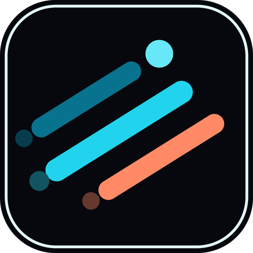

<p align="center">
  
</p>

<h1 align="center">MultiLane</h1>

<p align="center">
  <b>Мультикомнатный olcRTC-бондинг и мультипротокольный VPN-клиент.</b><br>
  Android, Windows, Linux, macOS, а также Linux-серверы и роутеры OpenWrt (<code>multilane-cli</code>).
</p>

<p align="center">
  <a href="LICENSE"></a>
  <a href="https://github.com/huKM565/multilane/releases"></a>
</p>

<p align="center">
  <a href="#возможности">Возможности</a> ·
  <a href="#протоколы">Протоколы</a> ·
  <a href="#multilane-cli">CLI и роутеры</a> ·
  <a href="#маршрутизация">Маршрутизация</a> ·
  <a href="#скачать">Скачать</a> ·
  <a href="#сборка-из-исходников">Сборка</a>
</p>

**MultiLane** — форк [Ghostlane](https://github.com/ghostlane-project/ghostlane) (на базе [alananisimov/olcbox](https://github.com/alananisimov/olcbox)) с упором на **мультикомнатный бондинг olcRTC** — объединение пула из 4, 8 или 12 WebRTC-комнат за балансировщиком Xray `leastLoad` и маршрутизатором `sing-box`, плюс стандартные VPN-протоколы и единый статический Go-бинарь для серверов и роутеров OpenWrt.

Это клиент, а не сервис: вы подключаете свою подписку, QR-код или ссылку на сервер (`multilane://`, `ghostlane://`, `olcrtc://`, `vless://`, `hysteria2://`, `trojan://`, `ss://`, `vmess://`).

## Возможности

- **Мультикомнатный бондинг olcRTC (4x / 8x / 12x):** поднимает параллельные WebRTC-комнаты и распределяет потоки через Xray `leastLoad` + `observatory` с автовосстановлением упавших комнат и отображением живого статуса.
- **Выбор наименее занятых комнат (`##bond-active: N`):** перед стартом клиент опрашивает комнаты Jitsi через лёгкий XMPP MUC-зонд (работает под белыми списками), отсеивает пустые комнаты без серверного релея и выбирает `N` самых свободных комнат с рандомным tie-break.
- **Мультипротокольность:** olcRTC, VLESS (Reality, TLS, plain, TCP/gRPC/WS/HTTPUpgrade/HTTP/XHTTP), Hysteria2, Trojan, Shadowsocks и VMess в одном приложении.
- **Умное подключение и failover:** проверяет транспорты перед подключением (включая проверку DPI-обрывов и белых списков) и автоматически переключается за активным TUN-интерфейсом без разрыва трафика.
- **Гибкая маршрутизация:** весь трафик, обход РФ / Ирана / Китая, только заблокированные сайты (Re:filter), а также пользовательские правила по доменам и IP/CIDR.
- **Кроссплатформенный GUI:** Kotlin Multiplatform + Compose UI для Android (включая Android TV, плитку быстрых настроек, Always-on VPN и выбор приложений), Windows (Wintun + UAC), Linux (`hev-socks5-tunnel` + опциональный kill switch) и macOS (TUN-демон / системный прокси).
- **Консольный клиент (`multilane-cli`):** один статический Go-бинарь (`amd64` / `arm64` / `armv7`) со встроенными `sing-box`, `Xray-core` и `olcRTC` для Linux-серверов и роутеров OpenWrt (включая избирательную маршрутизацию в стиле Podkop и параллельный LAN-прокси).
- **Раздача прокси по LAN:** публикация туннеля в локальную сеть в виде SOCKS5/HTTP-прокси.
- **Экспорт на роутер:** экспорт серверов подписки для Podkop (OpenWrt / sing-box) и XKeen (Keenetic / Xray).

## Протоколы

| Протокол | Движок |
| --- | --- |
| olcRTC (одна комната или пул 4x/8x/12x) | `olcRTC` (+ Xray `leastLoad` + `sing-box` для бонда) |
| VLESS + Reality (TCP, gRPC, HTTP/2) | `sing-box` |
| VLESS + TLS / plain (TCP, WS, HTTPUpgrade, HTTP/2) | `sing-box` |
| VLESS + XHTTP (Reality, TLS, plain) | `Xray-core` |
| Hysteria2 (включая обфускацию Salamander) | `sing-box` |
| Trojan, Shadowsocks (AEAD / 2022), VMess | `sing-box` |

Поддерживаемые площадки olcRTC: Яндекс Телемост, WB Stream, Сбер SaluteJazz, VK Звонки, МТС Линк и Jitsi (Mamba).

## `multilane-cli`

Фоновый демон и CLI для Linux-серверов и роутеров OpenWrt (`amd64`, `arm64`, `armv7`).

```sh
multilane-cli add 'https://…/sub/…'
multilane-cli list
multilane-cli connect PL --proxy              # локальный SOCKS5 + HTTP на 127.0.0.1:1080
multilane-cli connect PL --tun                # системный TUN (multilane0)
multilane-cli connect PL --tun --kill-switch  # блокировать трафик при падении туннеля
multilane-cli status
multilane-cli disconnect
```

Флаги демона `multilane-cli run`:
- `--direct-rules /etc/multilane-direct.rules` — домены, IP/CIDR и `.srs` rule-set'ы, идущие напрямую (всё остальное — в туннель).
- `--tunnel-rules /etc/multilane-tunnel.rules` — избирательный режим в стиле Podkop: в туннель идут только указанные домены, IP/CIDR и `.srs` rule-set'ы, остальной трафик идёт напрямую.
- `--proxy-listen <host:port>` (`--proxy-user`, `--proxy-pass`) — поднимает смешанный SOCKS5+HTTP прокси параллельно с `--tun` (работает на любой Linux-машине, сервере или роутере).
- `--connect <selector> --mode tun` — автоподключение при старте демона по сохранённым подпискам.

Подробная документация CLI: [docs/cli.md](docs/cli.md) и [cli/README.md](cli/README.md).

## Маршрутизация

Настраивается в **Настройки → Маршрутизация**:

| Режим | Поведение |
| --- | --- |
| Весь трафик | Весь трафик идёт через туннель. |
| Обход РФ / Ирана / Китая | Региональные домены, IP и локальные сети идут напрямую, остальное — через туннель. |
| Только заблокированные | Через туннель идут только заблокированные домены и подсети (Re:filter), остальное — напрямую. |
| Свои правила | Пользовательские домены и IP/CIDR имеют приоритет над списками режима. |

Наборы правил (`v2fly` и `Re:filter`) вшиты в приложение для работы офлайн.

## Подписки и ссылки

Импорт из буфера обмена, QR-кода, файла или deep-link:

```text
multilane://add?url=<payload>
multilane://add/<URL-подписки>
ghostlane://add?url=<payload>
```

Поддерживаются стандартные заголовки подписок (`profile-title`, `subscription-userinfo`, `support-url`, `profile-web-page-url`, `profile-update-interval`, `announce`, `fallback-url`, `new-url` / `new-domain`) и метаданные бондинга (`##rooms`, `##bond-room`, `##bond-vless`, `##bond-active`).

## Скачать

Готовые сборки публикуются в [GitHub Releases](https://github.com/huKM565/multilane/releases):

| Платформа | Файлы |
| --- | --- |
| Android | Universal APK |
| Windows | EXE-установщик, MSI-установщик, portable ZIP |
| Linux Desktop | AppImage (`amd64`) |
| macOS | DMG (`arm64`, `amd64`) |
| Linux / Роутеры CLI | статические бинари `multilane-cli` (`amd64`, `arm64`, `armv7`) |

## Сборка из исходников

### Требования

- **JDK 21** (целевой уровень Android — 17)
- **Go 1.26.5** (для `olcrtc`, `sing-box` и `multilane-cli`)
- **Android SDK 37 и NDK 28.2.13676358** (для сборки Android)
- Локальный репозиторий `olcrtc` в `../olcrtc` (или `OLCRTC_REPO=/путь/к/olcrtc`)

### Команды

| Задача | Команда |
| --- | --- |
| JVM-тесты | `./gradlew :sharedUI:jvmTest` |
| Сборка / запуск Desktop | `./gradlew :desktopApp:compileKotlin` / `./gradlew :desktopApp:run` |
| Linux AppImage | `./gradlew :desktopApp:packageReleaseLinuxAppImage` |
| Windows-установщики | `.\gradlew.bat :desktopApp:packageReleaseExe :desktopApp:packageReleaseMsi :desktopApp:packageReleasePortableZip` |
| Android debug APK | `./gradlew :androidApp:assembleGithubDebug` |
| Android release APK | `./gradlew :androidApp:assembleGithubRelease` |
| Сборка и тесты Go CLI | `cd cli && make vet && make test && make build` |
| Кросс-сборка CLI (`amd64`/`arm64`/`arm7`) | `cd cli && make build-all` |

### Артефакты сборки

| Цель | Путь |
| --- | --- |
| Android debug | `androidApp/build/outputs/apk/github/debug/androidApp-github-debug.apk` |
| Android release | `androidApp/build/outputs/apk/github/release/androidApp-github-release.apk` |
| Linux AppImage | `desktopApp/build/compose/binaries/main-release/appimage/MultiLane-<version>-linux-<arch>.AppImage` |
| Windows EXE / MSI / ZIP | `desktopApp\build\compose\binaries\main-release\{exe,msi,portable}\MultiLane-*` |
| macOS DMG | `desktopApp/build/compose/binaries/main-release/dmg/MultiLane-<version>.dmg` |
| Go CLI | `cli/dist/multilane-cli` / `cli/dist/linux-<arch>/multilane-cli` |

> Примечание: бинарники `sing-box` (собранный через `scripts/build-singbox.sh`) и `Xray-core` должны лежать в `desktopApp/src/main/resources/native/` для десктопных сборок и в `androidApp/jniLibs/<abi>/{libsingboxcore.so,libxraycore.so}` для Android.

## Благодарности и лицензия

MultiLane основан на [Ghostlane](https://github.com/ghostlane-project/ghostlane) и [alananisimov/olcbox](https://github.com/alananisimov/olcbox), использует [olcRTC](https://github.com/huKM565/olcrtc), [sing-box](https://github.com/SagerNet/sing-box) и [Xray-core](https://github.com/XTLS/Xray-core).

Условия лицензирования — в [LICENSE](LICENSE) и [THIRD_PARTY_NOTICES.md](THIRD_PARTY_NOTICES.md).
